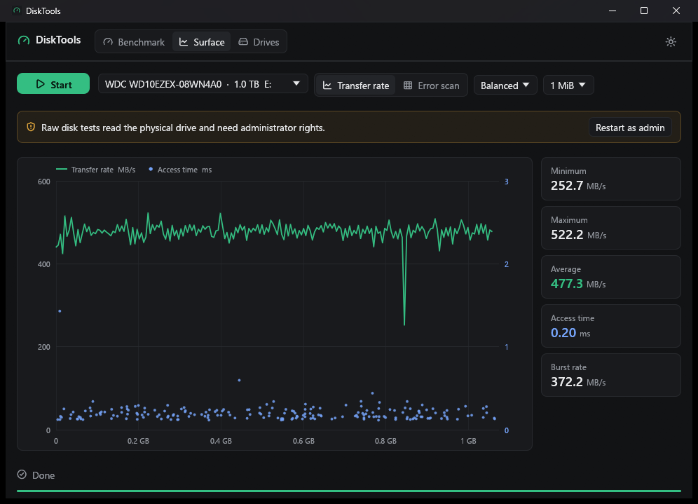
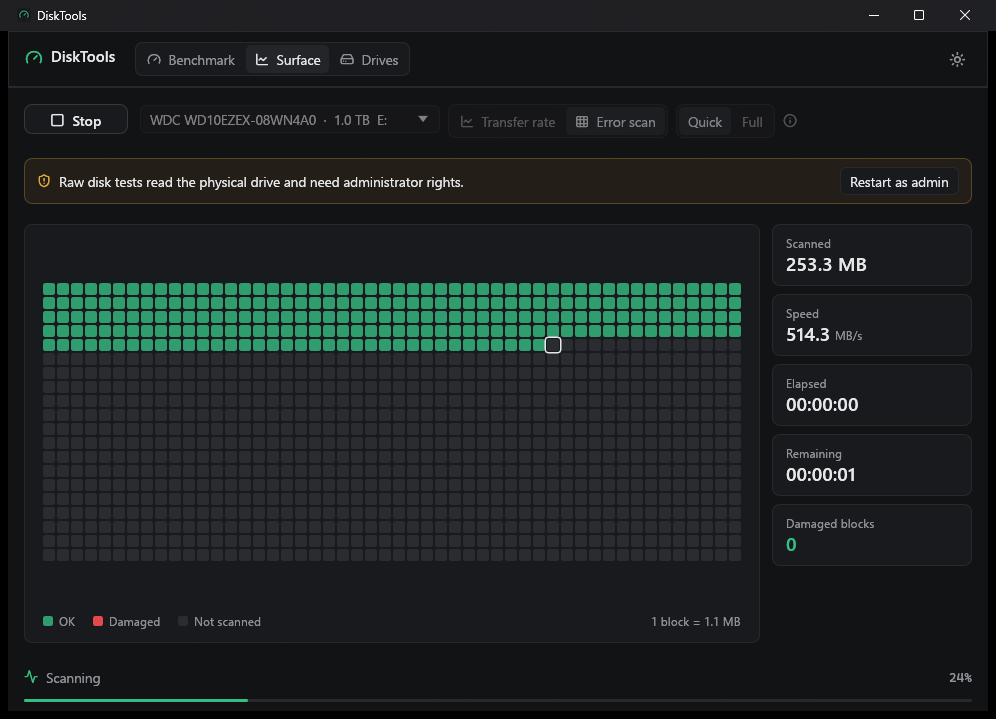

# DiskTools

A disk benchmark, surface tester and drive health viewer for Windows — in the spirit of CrystalDiskMark, HD Tune and CrystalDiskInfo — written in Rust with [egui](https://github.com/emilk/egui).






## Features

**Benchmark** (CrystalDiskMark-like)
- SEQ / RND tests with queue depth and thread count (`Default`: SEQ1M Q8T1, SEQ1M Q1T1, RND4K Q32T1, RND4K Q1T1; `NVMe SSD`: SEQ1M Q8T1, SEQ128K Q32T1, RND4K Q32T16, RND4K Q1T1)
- Unbuffered (`FILE_FLAG_NO_BUFFERING`) overlapped I/O on an I/O completion port, so the OS cache is bypassed and the queue depth is real
- Runs 1–9 (best run kept), test size 16 MiB – 64 GiB, measure time, interval, read/write/both
- Results in MB/s, GB/s, IOPS or average latency (μs); click a row label to run just that test
- "Copy" puts a text report on the clipboard
- The test file is written to `<drive>:\DiskToolsBench.tmp\` and deleted when the benchmark ends

**Surface** (HD Tune-like) — read-only tests on the physical drive
- **Transfer rate**: reads at 100 / 200 / 400 points across the whole drive and plots MB/s by position, with a random 4 KiB access-time sample per point (right axis). Shows minimum, maximum, average, mean access time and burst rate (cached reads). Read block size 64 KiB – 8 MiB.
- **Error scan**: 1,000-block map of the drive. *Quick* reads the first 8 MiB of every block; *Full* reads every byte. Blocks that fail to read are marked damaged. Shows speed, elapsed and remaining time.

**Drives** (CrystalDiskInfo-like)
- Every physical drive: model, firmware, serial, interface, capacity, drive letters, SSD/HDD, TRIM
- Health and temperature, power-on hours, host reads/writes
- ATA S.M.A.R.T. attribute table (current / worst / threshold / raw) for SATA drives
- NVMe SMART / Health Information log page for NVMe drives (percentage used, data written, power-on hours, …)

Health data and Surface tests need administrator rights. The installed (release) build always runs elevated.

## Build & run

```bash
cargo run
```

Release builds embed a manifest that **requires administrator** (UAC prompt on launch); debug and test builds run as the current user.

`--tab surface` or `--tab drives` opens on that tab. In debug builds, `DISKTOOLS_DEMO_TRANSFER=<file>` or `DISKTOOLS_DEMO_SCAN=<file>` runs a Surface test against a plain file at startup, which lets you check those views without administrator rights.

## Installer

Requires [Inno Setup 6](https://jrsoftware.org/isinfo.php). The script looks for `ISCC.exe` in `%LOCALAPPDATA%\Programs\Inno Setup 6\`, then `%LOCALAPPDATA%\InnoSetup\` (override with `$env:ISCC`).

```bash
pwsh installer/build.ps1
```

If DiskTools is running, `target\release\disktools.exe` is locked; build elsewhere with `pwsh installer/build.ps1 -TargetDir target\pkg`.

Output: `dist/disktools-<version>-setup-x64.exe`, which installs to `C:\Program Files\arizlab\disktools` with a Start menu shortcut (desktop shortcut optional).

## License

Licensed under either of

- Apache License, Version 2.0 ([LICENSE-APACHE](LICENSE-APACHE) or <https://www.apache.org/licenses/LICENSE-2.0>)
- MIT license ([LICENSE-MIT](LICENSE-MIT) or <https://opensource.org/licenses/MIT>)

at your option.

Unless you explicitly state otherwise, any contribution intentionally submitted for inclusion in this work by you, as defined in the Apache-2.0 license, shall be dual licensed as above, without any additional terms or conditions.

### Third-party

The icon font and the app icon use [Lucide](https://lucide.dev) icons, licensed under ISC (portions derived from Feather under MIT) — see [third-party/LUCIDE-LICENSE.txt](third-party/LUCIDE-LICENSE.txt).
