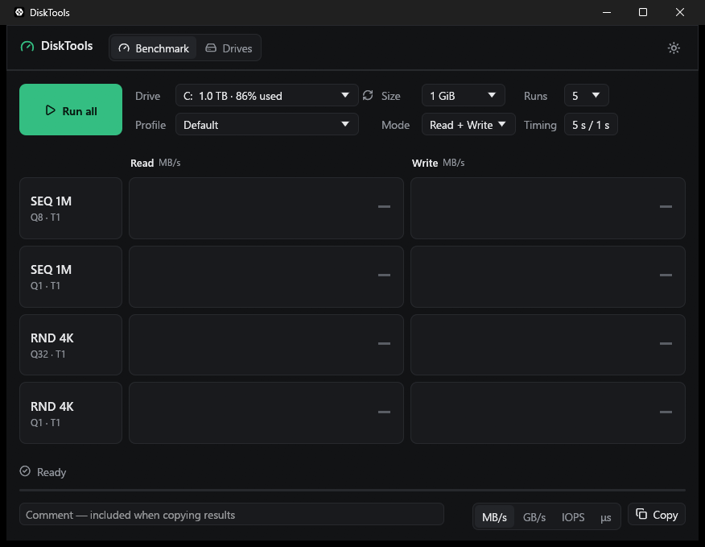
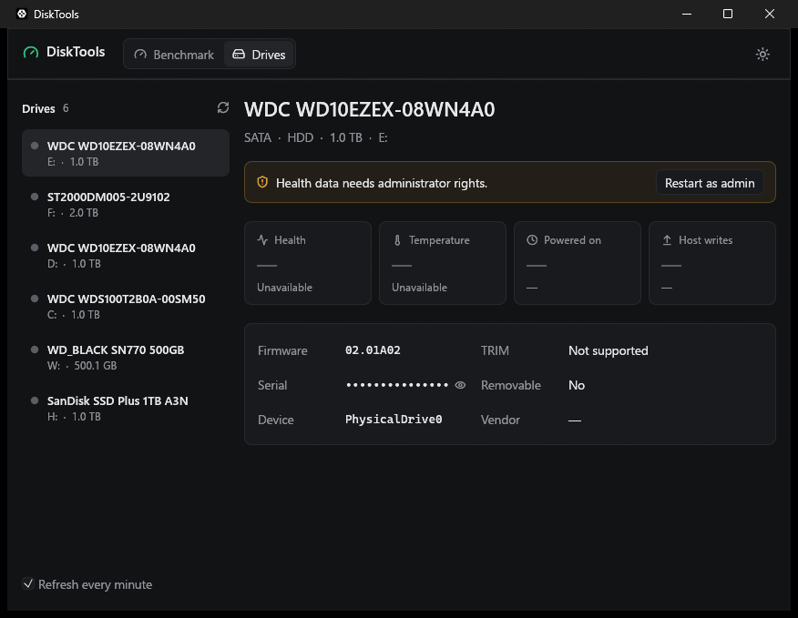

# DiskTools

A CrystalDiskMark + CrystalDiskInfo style utility for Windows, written in Rust with [egui](https://github.com/emilk/egui).




## Features

**Benchmark tab** (CrystalDiskMark-like)
- SEQ / RND tests with queue depth and thread count (`Default`: SEQ1M Q8T1, SEQ1M Q1T1, RND4K Q32T1, RND4K Q1T1; `NVMe SSD`: SEQ1M Q8T1, SEQ128K Q32T1, RND4K Q32T16, RND4K Q1T1)
- Unbuffered (`FILE_FLAG_NO_BUFFERING`) overlapped I/O on an I/O completion port, so the OS cache is bypassed and the queue depth is real
- Runs 1–9 (best run kept), test size 16 MiB – 64 GiB, measure time, interval, read/write/both
- Results in MB/s, GB/s, IOPS or average latency (μs); click a row label to run just that test
- "Copy results" puts a text report on the clipboard

**Disk Info tab** (CrystalDiskInfo-like)
- Every physical drive: model, firmware, serial, interface, capacity, drive letters, SSD/HDD, TRIM
- Health status and temperature badges
- ATA S.M.A.R.T. attribute table (current / worst / threshold / raw) for SATA drives
- NVMe SMART / Health Information log page for NVMe drives (percentage used, data written, power-on hours, …)

Health data requires administrator rights — use the **Restart as administrator** button in the title bar.

## Build & run

```bash
cargo run
```

Release builds embed a manifest that **requires administrator** (UAC prompt on launch); debug and test builds run as the current user.

## Installer

Requires [Inno Setup 6](https://jrsoftware.org/isinfo.php). The script looks for `ISCC.exe` in `%LOCALAPPDATA%\Programs\Inno Setup 6\`, then `%LOCALAPPDATA%\InnoSetup\` (override with `$env:ISCC`).

```bash
pwsh installer/build.ps1
```

Output: `dist/disktools-<version>-setup-x64.exe`, which installs to `C:\Program Files\arizlab\disktools` with a Start menu shortcut (desktop shortcut optional).

The test file is written to `<drive>:\DiskToolsBench.tmp\` and deleted when the benchmark ends.
